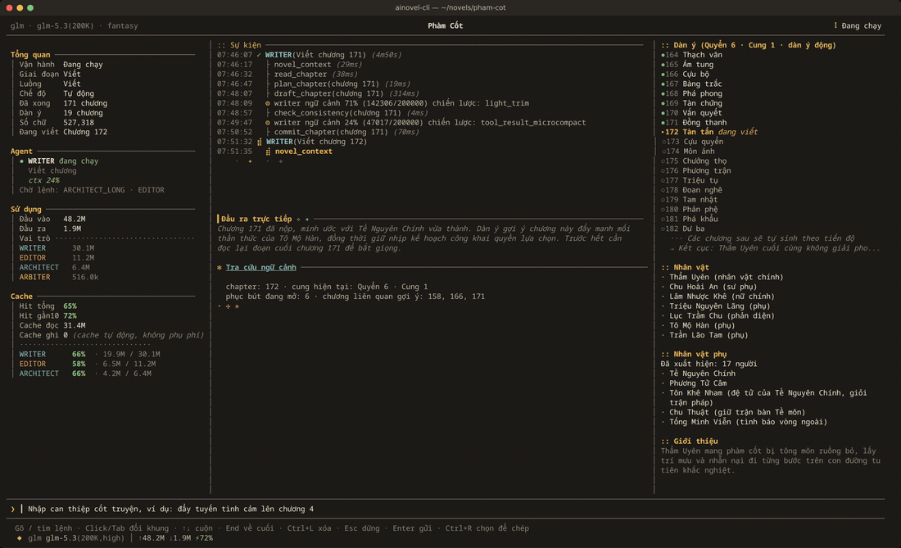
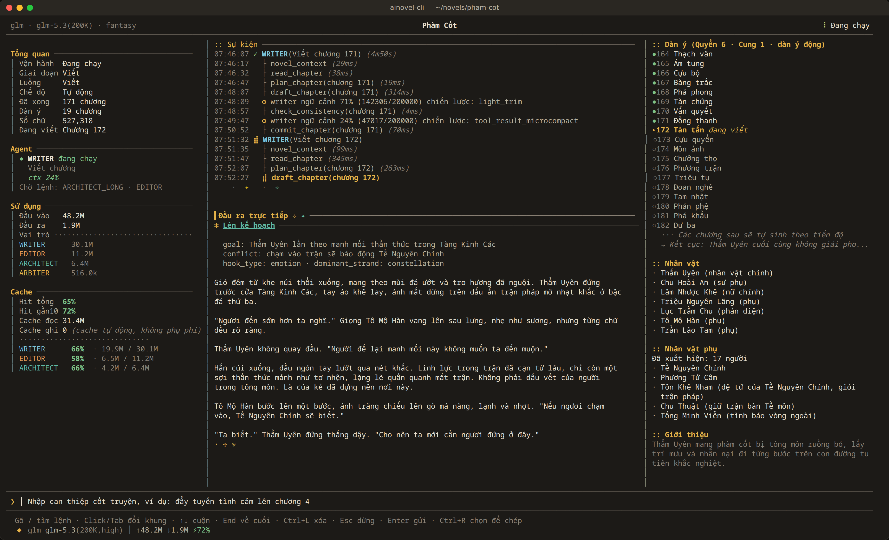

# ainovel-cli (bản tiếng Việt)

**Tiếng Việt** · [中文](README.zh.md)

Engine viết tiểu thuyết dài hoàn toàn tự động bằng AI, Việt hoá từ
[voocel/ainovel-cli](https://github.com/voocel/ainovel-cli). Một engine xác định chạy hết cả bộ truyện,
model chỉ được gọi đúng ở những chỗ cần phán đoán: Engine dựa trên dữ kiện để điều phối ba agent sáng tác
Architect / Writer / Editor, và chỉ đánh thức Arbiter khi cần phán quyết ngữ nghĩa. Từ một câu yêu cầu
đến cả bộ truyện, không cần người can thiệp.

<p align="center">
  
  
  <br><sub>Ảnh minh hoạ: giao diện TUI thật của bản Việt, dữ liệu truyện mô phỏng.</sub>
</p>

## Khác biệt so với upstream

- `language` trong config: `"vi"` (mặc định) viết truyện tiếng Việt; `"zh"` dùng prompt tiếng Trung gốc.
- Prompt, tài liệu tham khảo, phong cách tiếng Việt ở `assets/*/vi/`.
- Mô tả tool, chỉ dẫn ngữ cảnh, thông báo lỗi gửi cho model, giao diện TUI đều bằng tiếng Việt.
- Độ dài chương tính theo "chữ" (từ/âm tiết tách bởi khoảng trắng) khi `language=vi`.
- Ước lượng token cho tiếng Việt theo `bytes / 3` (bản gốc: chữ Hán `runes × 1.5`).
- Luật kiểm tra văn bản tiếng Việt: chữ Hán lẫn vào truyện, từ tiếng Anh lọt vào lời kể, đoạn lặp nguyên văn.
- `scripts/check-han` phát hiện chữ Hán còn sót trong chuỗi gửi cho model.

Cách đồng bộ với upstream: [SYNC.md](SYNC.md). README gốc (tiếng Trung): [README.zh.md](README.zh.md).

## Tính năng

- **Engine xác định + nhiều agent cộng tác** — Engine điều phối Architect / Writer / Editor theo bảng quyết định dựa trên dữ kiện; vòng lặp chính không tốn lượt LLM nào, hành vi kiểm thử vét cạn được.
- **Phán quyết ngữ nghĩa có thể kiểm toán** — chọn người lập kế hoạch, phân loại can thiệp, tìm lối thoát khi thất bại đều do Arbiter xử lý trong một lần gọi; mỗi phán quyết được ghi đĩa, phát lại được. Càng đơn giản càng ổn định, không dùng điều phối phức tạp.
- **Khôi phục theo từng bước** — mỗi tool chạy thành công là ghi checkpoint; sập giữa chừng thì khôi phục chính xác tới bước plan/draft/check/commit.
- **Lập kế hoạch cuốn chiếu hai tầng quyển–cung** — không lập kế hoạch toàn bộ chương một lần. Ban đầu chỉ dựng khung 2 quyển + chương chi tiết của cung 1; các cung/quyển sau được Architect mở rộng khi truyện viết tới, mỗi lần đều dựa trên tóm tắt phía trước và trạng thái nhân vật.
- **Gợi ý chương liên quan** — mỗi chương tự gợi ý các chương cũ liên quan theo bốn chiều: phục bút, nhân vật xuất hiện, thay đổi trạng thái, quan hệ; kết hợp đoạn báo trước chương sau, giữ mạch cho truyện 500+ chương.
- **Chiến lược ngữ cảnh thích ứng** — tự chuyển giữa toàn văn / cửa sổ trượt / tóm tắt phân tầng theo tổng số chương.
- **Duyệt chất lượng bảy chiều** — Editor chấm theo nhất quán thiết lập, hành vi nhân vật, nhịp, mạch kể, phục bút, móc câu, thẩm mỹ; chiều thẩm mỹ chia nhỏ thành chất cảm miêu tả / thủ pháp kể / độ phân biệt thoại / dùng từ / sức lay động, mỗi mục phải trích nguyên văn làm chứng.
- **Can thiệp thời gian thực** — gõ ý kiến vào ô nhập bất cứ lúc nào (không cần dừng), hệ thống tự đánh giá phạm vi ảnh hưởng và viết lại các chương bị ảnh hưởng.
- **Nghiệm thu từng chương (tuỳ chọn)** — mặc định vẫn tự động hoàn toàn; cần kiểm soát kỹ thì dùng `/review on`, mỗi lần `/next` chỉ cho qua một chương mới.
- **Hai lối vào TUI + Headless** — vừa theo dõi, can thiệp trên giao diện, vừa chạy liên tục không giao diện trên máy chủ, NAS, CI.
- **Nhiều LLM** — OpenRouter / Anthropic / Gemini / OpenAI / DeepSeek / Qwen / GLM / Grok / Ollama / Bedrock, đổi tuỳ ý.

## Kiến trúc

Thiết kế cốt lõi: **tầng dữ kiện xác định, tầng ngữ nghĩa tự chủ**. Chuyển trạng thái liệt kê được thì do code xác định chạy (Engine + Route); phán đoán có ranh giới rõ thì hỏi hàm LLM khi cần (Arbiter); sáng tác mở thì giao cho vòng lặp LLM tự chủ (Workers). Tóm lại: một Engine tuần tự xác định, ba Worker tự chủ, vài hàm Arbiter gọi khi cần, một tầng dữ kiện trên hệ thống file.

```
┌──────────────────────────────────────────────────────┐
│              Host / Engine (xác định)                │
│  Đọc Store → Route → chạy Worker → lặp               │
│  Khởi động / phân loại can thiệp / bế tắc → Arbiter  │
└────┬──────────┬──────────┬─────────────┬─────────────┘
     │          │          │             │
 ┌───▼─────┐ ┌──▼──────┐ ┌─▼───────┐ ┌───▼──────┐
 │Architect│ │ Writer  │ │ Editor  │ │ Arbiter  │
 │(vòng LLM)│ │(vòng LLM)│ │(vòng LLM)│ │(hàm LLM) │
 └───┬─────┘ └──┬──────┘ └─┬───────┘ └──────────┘
     └──────────┼──────────┘
                │ gọi tool (IO + checkpoint)
┌───────────────▼──────────────────────────────────────┐
│                       Store                          │
│  Progress / Checkpoint / Outline / Drafts / ...      │
└──────────────────────────────────────────────────────┘
```

- **Engine** — mỗi vòng đọc dữ kiện từ Store, phát việc cho Worker theo bảng Route; chỉ thi hành quyết định, không tham gia phán đoán văn chương. Khôi phục sau sập = đọc store chạy tiếp, không có phiên nào cần khôi phục.
- **Arbiter** — phán quyết ngữ nghĩa khi cần (chọn người lập kế hoạch, phân loại can thiệp, lối thoát khi thất bại/bế tắc); dữ kiện vào, quyết định có cấu trúc ra, mỗi phán quyết ghi đĩa để kiểm toán/phát lại.
- **Workers** — Architect / Writer / Editor, mỗi agent có context riêng, cộng tác qua sản phẩm trong Store.
- **Tools** — IO nguyên tử trên từng file + phát lại idempotent; nộp chương dùng Saga bền vững + checkpoint, chỉ trả JSON dữ kiện, không kèm chỉ thị.

### Vai trò các agent

| Vai | Nhiệm vụ | Tool |
|-----|----------|------|
| **Arbiter** | Phán quyết: chọn người lập kế hoạch lúc khởi động, phân loại can thiệp, lối thoát khi thất bại/bế tắc | Không (một lần gọi LLM, xuất quyết định có cấu trúc) |
| **Architect** | Tạo tên truyện, giới thiệu, tiền đề, dàn ý, hồ sơ nhân vật, luật thế giới | `novel_context` `save_book` `save_foundation` |
| **Writer** | Tự chủ lên ý, viết, tự duyệt và nộp một chương | `novel_context` `read_chapter` `plan_chapter` `draft_chapter` `check_consistency` `commit_chapter` |
| **Editor** | Đọc nguyên văn, duyệt ở cả tầng cấu trúc lẫn thẩm mỹ | `novel_context` `read_chapter` `save_review` `save_arc_summary` `save_volume_summary` |

### Quy trình viết

```
Yêu cầu → Arbiter chọn người lập KH → Architect dựng khung + cung đầu → Writer viết từng chương → Editor duyệt theo cung
          (phán quyết ghi đĩa)                                          ↑                          │
                                                                        ├── viết lại / trau chuốt ◄┘
                                                                        │
                                                         Architect mở rộng cung/quyển kế
                                                       (dựa trên tóm tắt + ảnh chụp nhân vật)
```

"Tiếp theo giao cho ai" ở mỗi bước do bảng Route của Engine suy ra từ dữ kiện trong Store (cố định bằng kiểm thử vét cạn hàng chục nghìn tổ hợp), không tốn lượt LLM nào.

Writer hoàn thành mỗi chương theo thứ tự cố định (nội dung tự chủ hoàn toàn, thứ tự gọi tool thì nghiêm ngặt):

1. `novel_context` — nạp ngữ cảnh (tóm tắt trước, phục bút, trạng thái nhân vật, luật phong cách, chương liên quan)
2. `read_chapter` — đọc lại đoạn trước để bắt giọng và nhịp
3. `plan_chapter` — lên mục tiêu, xung đột, đường cong cảm xúc của chương
4. `draft_chapter` — ghi toàn bộ chương
5. `check_consistency` — đối chiếu dữ liệu trạng thái để kiểm tra nhất quán (phải sau draft)
6. `commit_chapter` — nộp bản cuối, ghi các trường dữ kiện (`arc_end` / `next_chapter` / bể phản hồi dàn ý...), bước kế do Engine suy ra theo Route

### Quy tắc chuyển trạng thái

Trạng thái chạy chia hai tầng:

- **Phase** — giai đoạn lớn: thiết lập, đang viết hay đã xong
- **Flow** — luồng đang hoạt động: viết bình thường, duyệt, viết lại, trau chuốt hay xử lý can thiệp

#### Phase

`Phase` chỉ tiến, không lùi:

```text
init -> premise -> outline -> writing -> complete
  \-------> outline ------^
  \--------------> writing
```

- `init` — đã tạo nhiệm vụ, chưa có thiết lập ổn định
- `premise` — đã lưu tiền đề truyện
- `outline` — đã lưu dàn ý, có thể vào viết chính thức
- `writing` — đang trong giai đoạn viết chương
- `complete` — toàn bộ quy trình kết thúc

Cho phép cập nhật cùng trạng thái (`writing -> writing`) và tiến lên (`outline -> writing`); cấm lùi (`writing -> premise`, `complete -> writing`).

#### Flow

`Flow` chỉ mô tả luồng hoạt động trong giai đoạn viết:

```text
writing   -> reviewing / rewriting / polishing / steering / writing
reviewing -> writing / rewriting / polishing / steering / reviewing
rewriting -> writing / steering / rewriting
polishing -> writing / steering / polishing
steering  -> writing / reviewing / rewriting / polishing / steering
```

- `writing` — viết chương kế bình thường
- `reviewing` — Editor đang duyệt
- `rewriting` — xử lý chương bắt buộc viết lại
- `polishing` — xử lý chương chỉ cần trau chuốt
- `steering` — đang đánh giá và xử lý can thiệp của người dùng

Cấm các bước nhảy bất thường như `rewriting -> reviewing`. Các quy tắc này được code kiểm tra tập trung.

### Lập kế hoạch cuốn chiếu cho truyện dài

Cách truyền thống lập kế hoạch mọi chương một lần, tới 300+ chương thì dàn ý rỗng, nhịp như chạy deadline. Hệ thống dùng **la bàn + tầm nhìn cuốn chiếu**, mô phỏng cách tác giả web novel thật sự viết:

```
Kế hoạch ban đầu            Hết một cung                  Hết một quyển
┌────────────────────┐    ┌──────────────────────┐    ┌──────────────────────┐
│ Hướng kết (la bàn) │    │ Editor duyệt cung    │    │ Editor duyệt quyển   │
│ Khởi đầu 2 quyển   │    │ Tóm tắt cung + ảnh   │    │ Tóm tắt quyển        │
│ Chương chi tiết    │ →  │ chụp nhân vật        │ →  │ Architect tự tạo     │
│ cung 1             │    │ Architect mở cung kế │    │ quyển kế + cập nhật  │
│ Nhân vật + thế giới│    │ Writer viết tiếp     │    │ la bàn               │
└────────────────────┘    └──────────────────────┘    └──────────────────────┘
```

- **La bàn (Compass)** — hướng kết + các tuyến dài đang chạy + ước lượng quy mô; Architect cập nhật ở mỗi ranh giới quyển, hướng truyện có thể tiến hoá theo quá trình viết.
- **Sinh theo nhu cầu** — viết xong quyển hiện tại, Architect tự tạo quyển kế dựa trên nội dung đã viết.
- **Cung khung** — chỉ có goal + số chương ước lượng, tới nơi mới mở thành chương chi tiết.
- **Tinh chỉnh dần** — mỗi lần mở rộng đều dựa trên tóm tắt, ảnh chụp nhân vật, luật phong cách; càng về sau càng chính xác.
- **Mẫu nhịp chung** — cung trưởng thành đột phá / cung thi đấu đối kháng / cung thám hiểm khám phá / cung ân oán xung đột / cung chuyển tiếp đời thường, mỗi loại có mật độ tham chiếu và ánh xạ thể loại phù hợp.

### Quản lý ngữ cảnh truyện dài

Truyện 500+ chương dùng tóm tắt ba cấp + đường ống nén bốn cấp + gợi ý thông minh:

```
Quyển (Volume) → tóm tắt quyển
└── Cung (Arc) → tóm tắt cung + ảnh chụp nhân vật + luật phong cách
    └── Chương (Chapter) → tóm tắt chương (cửa sổ trượt 3 chương gần nhất)
```

- **Tóm tắt phân tầng** — gần dùng tóm tắt chương, vừa dùng tóm tắt cung, xa dùng tóm tắt quyển.
- **Gợi ý chương liên quan** — tra ngược chương cũ theo phục bút, nhân vật, thay đổi trạng thái, quan hệ; Writer đọc lại khi cần.
- **Báo trước chương sau** — nạp dàn ý chương kế để Writer thiết kế móc cuối chương và nối phục bút.
- **Phát hiện ranh giới cung** — tự nhận biết hết cung/quyển, kích hoạt duyệt, sinh tóm tắt và mở rộng cung/quyển kế.

#### Đường ống nén ngữ cảnh

Khi hội thoại vượt cửa sổ ngữ cảnh của model, nén lần lượt từ rẻ đến đắt:

```
ToolResultMicrocompact → LightTrim → StoreSummaryCompact → FullSummary
  dọn kết quả tool cũ    cắt văn dài   nén từ store, 0 LLM   LLM tóm tắt dự phòng
```

- **StoreSummaryCompact** — riêng Writer, dùng tóm tắt chương, ảnh chụp nhân vật, sổ phục bút có sẵn trong store thay cho tin nhắn cũ, không tốn LLM.
- **FullSummary chuyên cho tiểu thuyết** — prompt tóm tắt hướng vào mạch truyện, yêu cầu giữ trạng thái nhân vật, manh mối phục bút, mục cần sửa từ duyệt, mốc phong cách.
- **Gói khôi phục sau nén** — sau FullSummary tự chèn kế hoạch chương hiện tại, dàn ý và ảnh chụp nhân vật, tránh Writer "mất trí nhớ".
- **Cầu chì** — nén thất bại liên tiếp thì tự bỏ qua và cảnh báo rõ, chế độ nửa mở, vòng sau tự thử lại.
- **Ước lượng token** — tiếng Việt `bytes / 3`, tiếng Trung `runes × 1.5`, tránh ước thấp khiến nén kích hoạt muộn.
- **Màu sức khoẻ ngữ cảnh trên TUI** — xanh (<70%) → vàng (70-85%) → đỏ (>85%).

## Cài đặt

Cần Go 1.25 trở lên. Bản Việt hoá cài từ mã nguồn:

```bash
git clone git@github.com:jhin1m/ainovel-cli-vi.git
cd ainovel-cli-vi
go build -o ainovel-cli ./cmd/ainovel-cli
./ainovel-cli --version
```

Có thể chép `ainovel-cli` vào thư mục trong `PATH` (vd. `~/.local/bin`).

> Lưu ý: script cài một dòng, `go install github.com/voocel/...`, image `ghcr.io/voocel/ainovel-cli` và lệnh
> `ainovel-cli update` đều lấy bản phát hành **upstream (tiếng Trung)**. Không dùng chúng cho bản Việt.

Lần chạy TUI đầu tiên tự vào phần hướng dẫn (chọn Provider → nhập API Key → Base URL → tên model):

```bash
ainovel-cli
```

### Headless

`--headless` chạy không TUI, hợp với máy chủ, NAS, CI hoặc tác vụ nền. Chế độ này không có hướng dẫn cấu hình lần đầu,
hãy chạy `ainovel-cli` một lần để cấu hình hoặc tự tạo `~/.ainovel/config.json`.

```bash
mkdir -p ~/novels/tien-hiep-1 && cd ~/novels/tien-hiep-1

# Bắt đầu truyện mới bằng một câu yêu cầu
ainovel-cli --headless --prompt "Viết truyện tiên hiệp dài khoảng 100 chương, nhân vật chính xuất thân tạp dịch ngoại môn"

# Đọc yêu cầu từ file
ainovel-cli --headless --prompt-file yeu-cau.txt

# Tiếp tục bộ truyện dang dở trong thư mục này
ainovel-cli --headless
```

`--prompt` và `--prompt-file` chỉ dùng được ở headless và không dùng cùng lúc. Đầu ra stream của model ghi ra stdout,
sự kiện ghi ra stderr, log đầy đủ ở `output/novel/logs/headless.log`. Treo máy lâu nên chạy trong `tmux`/`screen` hoặc `nohup`:

```bash
nohup ainovel-cli --headless --prompt-file yeu-cau.txt > run.out 2> run.err &
```

Mẫu `yeu-cau.txt` cho bộ dài:

```text
Viết một bộ tiểu thuyết tiên hiệp tiếng Việt khoảng 100 chương, mỗi chương khoảng 3000 chữ.
Nhân vật chính: Lâm Phong, đệ tử tạp dịch của Thanh Vân Tông, linh căn bị cho là phế.
Giọng văn: kể ngôi thứ ba, nhịp nhanh, thoại tự nhiên, tên riêng dùng âm Hán-Việt.
Tuyến chính: từ ngoại môn lên nội môn, vạch trần âm mưu của trưởng lão, cuối cùng phi thăng.
```

### Docker

Image dựng từ mã nguồn trong repo này (không kéo image upstream). Nên mount thư mục config và thư mục làm việc ra máy chủ:

```bash
docker build -t ainovel-cli-vi .
mkdir -p config workspace

# TUI
docker run --rm -it \
  -v "$PWD/config:/root/.ainovel" \
  -v "$PWD/workspace:/workspace" \
  ainovel-cli-vi

# Headless
docker run --rm \
  -v "$PWD/config:/root/.ainovel" \
  -v "$PWD/workspace:/workspace" \
  ainovel-cli-vi \
  --headless --prompt "Viết truyện huyền huyễn dài, nhân vật chính khởi đầu từ một thị trấn biên thuỳ"
```

Dùng Compose thì build trước để không kéo image upstream:

```bash
docker compose build
docker compose run --rm ainovel
docker compose run --rm ainovel --headless --prompt "Viết một truyện ngắn trinh thám"
```

### Màn hình khởi động TUI

Có hai chế độ trước khi vào sáng tác:

- **Bắt đầu nhanh** — một câu là bắt đầu viết ngay.
- **Đồng sáng tác** — trò chuyện nhiều lượt với AI để làm rõ ý tưởng, **bản nháp chỉ thị sáng tác được cập nhật trực tiếp ở bên phải**; mỗi lượt AI đưa 1-3 gợi ý, bấm phím số liên tiếp để ghép vào, sửa rồi gửi, nhấn `Ctrl+S` để vào sáng tác chính thức.

Cả hai đều quy về cùng một chỉ thị sáng tác rồi chạy cùng một engine.

Nếu đã có sẵn thiết lập thế giới hoặc dàn ý dài, có thể tạo truyện mới từ file ngay ở màn hình chào:

```text
/start ./dan-y.md
```

`/start` dùng toàn văn file làm yêu cầu ban đầu, giao cho Architect sắp xếp thành thiết lập nội bộ và dàn ý động; nội dung file
không bị coi là chương đã viết. Muốn nhập truyện có sẵn để viết tiếp thì dùng `/import`.

### Quản lý nhiều bộ truyện

Mỗi bộ truyện gắn với thư mục khởi động, dữ liệu nằm ở `./output/novel/`. Đổi thư mục = bộ mới; `cd` về thư mục cũ rồi chạy =
tự khôi phục từ checkpoint gần nhất. Config `~/.ainovel/config.json` dùng chung, không cần sao chép.

## Cấu hình

Lần chạy đầu tự sinh `~/.ainovel/config.json`. Trong TUI, `/config` để thêm/sửa Provider, lưu nhiều model và đặt cửa sổ ngữ cảnh
cho từng model; lưu xong có hiệu lực ngay. `/model` để chuyển giữa các model đã lưu.

Có thể tự tạo file config, tham khảo `config.example.jsonc` ở gốc repo (lần hướng dẫn đầu cũng chép một bản vào
`~/.ainovel/config.example.jsonc`).

Ví dụ dùng GLM qua z.ai (gói coding plan, endpoint tương thích OpenAI). Key dưới đây là key giả:

```json
{
  "provider": "glm",
  "model": "glm-5.3",
  "reasoning_effort": "high",
  "language": "vi",
  "style": "fantasy",
  "providers": {
    "glm": {
      "api_key": "sk-glm-xxxxxxxxxxxxxxxxxxxxxxxx",
      "base_url": "https://api.z.ai/api/coding/paas/v4",
      "models": [
        { "name": "glm-5.3" },
        { "name": "glm-5.3-flash" }
      ]
    }
  }
}
```

Ví dụ OpenRouter với nhiều model và header tuỳ chỉnh:

```jsonc
{
  "provider": "openrouter",
  "model": "google/gemini-2.5-flash",
  "reasoning_effort": "medium",
  "providers": {
    "openrouter": {
      "api_key": "sk-or-v1-xxx",
      "base_url": "https://openrouter.ai/api/v1",
      "models": [
        { "name": "google/gemini-2.5-flash", "context_window": 200000 },
        { "name": "google/gemini-2.5-pro", "context_window": 1000000 }
      ],
      "extra": {
        "user_agent": "my-client/1.0",
        "headers": { "X-Custom-Client": "my-client" }
      }
    }
  },
  "style": "default"
}
```

### Các trường chính

- `language`: `"vi"` hoặc `"zh"`. Bỏ trống = `"vi"`.
- `style`: `default` (chung) / `fantasy` (huyền huyễn, tiên hiệp) / `romance` (ngôn tình) / `suspense` (trinh thám, hồi hộp).
- `reasoning_effort`: `off` / `low` / `medium` / `high` / `xhigh` / `max`; bỏ trống = theo mặc định của model/provider.
  `roles.<vai>.reasoning_effort` ghi đè theo vai. Config lưu **ý định gốc**, khi gửi thực tế mới kẹp theo **khả năng của model
  hiện tại**; đổi sang model yếu hơn chỉ hạ giá trị lần đó, đổi lại model mạnh thì tự khôi phục.
- Với GLM-5.x nên dùng `"low"`, `"high"` hoặc `"max"`. Giá trị `"medium"` có lúc bị z.ai từ chối
  (HTTP 400, mã 1210 "This model always engages in thinking and cannot be disabled"), Arbiter sẽ tạm dừng bộ máy.
  Có thể ghi đè riêng cho một thư mục truyện bằng `./.ainovel/config.json` chỉ chứa `{"reasoning_effort": "high"}`.
- `providers.<tên>.models`: danh sách model. `name` là tên gửi cho Provider; `context_window` là cửa sổ nén ngữ cảnh riêng của model;
  `json_schema` là ghi đè ba trạng thái cho structured output gốc (`true` hỗ trợ, `false` không hỗ trợ, bỏ trống = theo adapter).
  Dạng mảng chuỗi cũ vẫn đọc được, lần lưu kế qua `/config` sẽ chuẩn hoá thành đối tượng.
- Cửa sổ ngữ cảnh lấy theo thứ tự: giá trị riêng của model → `context_window` cấp gốc (cũ) → registry model → mặc định 200K.
  Nó chỉ ảnh hưởng thời điểm nén ngữ cảnh cục bộ, không đổi giới hạn thật của API.
- `providers.<tên>.api`: chỉ cho `type: "openai"` hoặc `openai` dựng sẵn; `chat` (mặc định, `base_url + /chat/completions`) hoặc
  `responses` (`base_url + /responses`). `base_url` có sẵn đường dẫn (như `/api/v3` của Volcengine) thì giữ nguyên; chỉ có tên miền
  thì mặc định thêm `/v1`. Proxy kiểu Codex thường cần `responses`.
- `providers.<tên>.extra`: cấu hình cấp provider truyền cho HTTP client (`user_agent`, `headers`, `anthropic_beta`...);
  `providers.<tên>.extra_body` mới là tham số mở rộng trong body request, đừng nhầm hai trường.
- File config chứa API key: không commit. `.ainovel/` đã nằm trong `.gitignore`.

### Thứ tự tìm config (sau đè trước)

1. `~/.ainovel/config.json` — toàn cục
2. `./.ainovel/config.json` — ghi đè theo dự án (tuỳ chọn)

`./.ainovel/` là bản soi của `~/.ainovel/`: cùng cấu trúc, chỉ khác gốc. Config đặt ở `./.ainovel/config.json`, luật viết đặt ở
`./.ainovel/rules/*.md` (xem phần "Khử giọng AI và luật tuỳ chỉnh").

- Trường đơn (`provider`, `model`, `reasoning_effort`, `style`...) thì file sau đè file trước.
- `providers` và `roles` gộp theo key, mục trùng tên thì đè theo từng trường.
- Trường không khai báo kế thừa tầng trên, vd. config dự án chỉ ghi `base_url` vẫn giữ `api_key` toàn cục.
- Không xoá được giá trị tầng trên bằng chuỗi rỗng; muốn xoá thì sửa trực tiếp file ưu tiên cao hơn.

> ⚠️ Giá trị `provider` (và `roles.*.provider`) là **tên key** trong `providers`, không phải tên giao thức. Nếu config dự án trỏ
> `provider` sang một tài khoản không có trong `providers` toàn cục, phải bổ sung luôn thông tin đăng nhập (`api_key` / `base_url`)
> ở config dự án, nếu không khởi động sẽ báo chưa cấu hình thông tin đăng nhập.

### `/config` và `/model`

`/config` chỉ để **sửa định nghĩa Provider** (giao thức / API Key / Base URL / thư viện model), không quyết định "đang dùng model nào" —
đổi model và mức suy luận dùng `/model`. Danh sách model: `↑↓` chọn dòng, `←→` chọn trường, `Enter` sửa tại chỗ ID model hoặc cửa sổ
ngữ cảnh, `Delete` xoá; thêm model mới ở cuối danh sách. Cửa sổ nhập số nguyên, `128K`, `1M`, để trống = tự giải. Khi lưu sẽ **ghi vào
file config đang có hiệu lực gần nhất** (có `./.ainovel/config.json` thì ghi file đó, không thì ghi toàn cục) và áp dụng nóng. Đổi ID model
sẽ đồng bộ các tham chiếu ở cấp gốc, roles và fallback trong cùng một lần ghi nguyên tử. Model đang được tham chiếu không xoá trực tiếp được,
cần chuyển đi bằng `/model` trước. API Key luôn bị ẩn khi nhập.

Trong chi tiết Provider, API Key và Base URL sửa tại chỗ được, key cũ chỉ hiện đầu/cuối đã che. "Kiểm tra kết nối" gửi một request thật
tối thiểu bằng bản nháp hiện tại và model đã chọn (có thể tốn chút API), kết quả không chặn việc lưu. Các cấu hình nâng cao như `extra`,
`extra_body`, `stream_idle_timeout` vẫn sửa trong file config thật mà giao diện hiển thị.

`/model` đổi provider, model hoặc mức suy luận rồi ghi lại vào file config đang hiệu lực (giống `/config`).

### Mỗi vai một model

Trường `roles` gán model riêng cho từng agent, vai không cấu hình dùng model mặc định:

```jsonc
{
  "provider": "openrouter",
  "model": "google/gemini-2.5-flash",
  "reasoning_effort": "medium",
  "providers": {
    "openrouter": { "api_key": "sk-or-v1-xxx", "base_url": "https://openrouter.ai/api/v1" },
    "anthropic": { "api_key": "sk-ant-xxx" }
  },
  "roles": {
    "writer": { "provider": "anthropic", "model": "claude-sonnet-4", "reasoning_effort": "high" },
    "architect": { "provider": "openrouter", "model": "google/gemini-2.5-pro", "reasoning_effort": "low" }
  }
}
```

Các vai cấu hình được: `architect` / `writer` / `editor`, và ba hàm ngữ nghĩa của đường ống nhập `import_segment` / `import_analyze` /
`import_synthesize` (không cấu hình thì dùng architect; có thể trỏ bước chia chương mang tính máy móc sang model rẻ hơn).
Arbiter luôn dùng model mặc định, hiện chưa cho cấu hình riêng.

### Proxy tuỳ chỉnh

Chọn Provider bất kỳ rồi điền địa chỉ proxy, hoặc dùng Custom Proxy và chỉ định giao thức API. `api_key` của proxy tuỳ chỉnh là tuỳ chọn:

```jsonc
{
  "provider": "my-proxy",
  "model": "gpt-4o",
  "providers": {
    "my-proxy": {
      "type": "openai",
      "base_url": "https://proxy.example.com/v1",
      "extra": {
        "user_agent": "my-client/1.0",
        "headers": { "X-Custom-Client": "my-client" }
      }
    }
  }
}
```

Provider hỗ trợ: `openrouter` / `anthropic` / `gemini` / `openai` / `deepseek` / `qwen` / `glm` / `grok` / `ollama` / `bedrock` và mọi proxy tuỳ chỉnh.

Proxy giao thức Anthropic chỉ cho client Claude Code truy cập: đặt `type` là `anthropic`, `anthropic_beta` ở cấp gốc của `extra`,
các header Stainless trong `extra.headers`:

```jsonc
{
  "provider": "claude-code-proxy",
  "model": "claude-sonnet-4-6",
  "providers": {
    "claude-code-proxy": {
      "type": "anthropic",
      "api_key": "sk-xxx",
      "base_url": "https://proxy.example.com",
      "extra": {
        "user_agent": "claude-code/2.1.183",
        "anthropic_beta": "claude-code-20250219",
        "headers": {
          "X-Stainless-Lang": "js",
          "X-Stainless-Package-Version": "0.94.0",
          "X-Stainless-Runtime": "node"
        }
      }
    }
  }
}
```

Proxy giao thức OpenAI/NewAPI chỉ cho client Codex truy cập: đặt `type` là `openai`, dùng `extra.user_agent` thay `litellm-go/0.1`
mặc định và chuyển tiếp header nhận diện Codex qua `extra.headers`. `Session_id` và `X-Codex-Turn-Metadata` nên thay bằng giá trị ngẫu
nhiên cố định; chúng tương thích cả mẫu chuyển tiếp Codex của New API lẫn kiểm tra dấu vân tay `x-codex-*` của sub2api:

```jsonc
{
  "provider": "codex-proxy",
  "model": "gpt-5.4",
  "providers": {
    "codex-proxy": {
      "type": "openai",
      "api_key": "sk-xxx",
      "base_url": "https://proxy.example.com/v1",
      "models": [
        { "name": "gpt-5.4", "context_window": 400000 },
        { "name": "gpt-5.4-mini" },
        { "name": "MiniMax-M3", "context_window": 1000000 }
      ],
      "api": "responses",
      "extra": {
        "user_agent": "codex-tui/0.142.3 (Mac OS 26.5.1; arm64) Apple_Terminal/470.2 (codex-tui; 0.142.3)",
        "headers": {
          "Originator": "codex-tui",
          "Session_id": "replace-with-random-session-id",
          "X-Codex-Turn-Metadata": "replace-with-random-turn-metadata"
        }
      }
    }
  }
}
```

Về `api_key`:

- Các API được host như `openrouter` / `anthropic` / `gemini` / `openai` / `deepseek` / `qwen` / `glm` / `grok` thường cần `api_key`.
- `ollama` và `bedrock` không bắt buộc `api_key`; Bedrock cần `region`, `access_key_id`, `secret_access_key` (tuỳ chọn `session_token`) trong `extra`.
- Proxy tuỳ chỉnh đã chỉ định `type` không bắt buộc `api_key`.

Ví dụ `ollama` cục bộ:

```jsonc
{
  "provider": "ollama",
  "model": "qwen3:latest",
  "providers": {
    "ollama": {
      "base_url": "http://localhost:11434/v1"
    }
  }
}
```

### Khử giọng AI và luật tuỳ chỉnh

Có sẵn một nền khử giọng AI: danh sách đen máy móc (câu sáo / từ mỏi, dựng trong code `rules.SystemDefaults()`, kiểm tra xác định khi commit)
+ tiêu chí ngữ nghĩa `assets/references/vi/anti-ai-tone.md` (chèn cho writer tránh và editor trích chứng). Bản Việt còn thêm luật bắt chữ Hán
lẫn vào truyện, từ tiếng Anh lọt vào lời kể và đoạn lặp nguyên văn.

Thêm sở thích riêng **không cần sửa mã nguồn**: trong `~/.ainovel/rules/` (toàn cục, đặt file `.md` bất kỳ, gộp theo thứ tự tên file) hoặc
`./.ainovel/rules/` (riêng bộ này, cùng dạng), **viết bằng lời thường** (vd. "nhân vật chính đừng thánh mẫu", "dùng nhiều cảm giác cơ thể",
"mỗi chương khoảng 3000 chữ", "đừng dùng cụm 'ở một mức độ nào đó'") — không cần định dạng, không YAML. Hệ thống dùng model chuẩn hoá các yêu cầu
này thành ảnh chụp luật của bộ truyện (khoảng độ dài / từ cấm / ngưỡng từ mỏi... + sở thích phong cách), tự tuân theo khi viết và tự kiểm khi nộp;
cộng dồn với nền mặc định, tầng gần ghi đè tầng xa.

### Tuỳ chỉnh giọng văn (Voice Layer)

Tiêu chuẩn viết và tiêu chí khử giọng AI cũng ghi đè được, **không sửa mã, không build lại**. Hai cấp: `<thư mục đầu ra>/style/` (riêng bộ
truyện, đi theo truyện) > `~/.ainovel/style/` (toàn cục):

```
style/
├── voice.md                          # đoạn bổ sung tiêu chuẩn viết (giữ bản dựng sẵn, yêu cầu của bạn nối sau, ưu tiên cao hơn)
├── anti-ai-tone.md                   # đoạn bổ sung tiêu chí khử giọng AI (như trên)
├── styles/
│   └── xianxia.md                    # phong cách mới (tên file = tên phong cách, config `style: xianxia` là dùng)
│                                     # (trùng tên dựng sẵn như fantasy.md thì thay toàn bộ)
└── genres/
    └── xianxia/
        └── style-references.md       # tài liệu tham khảo thể loại của phong cách đó (thay toàn file)
```

Ghi nhớ nhanh: **văn bản hướng dẫn (voice / anti-ai-tone) thì nối thêm, preset phong cách (styles / genres) thì thay cả file**. Mức ưu tiên
khi nối thêm là chỉ dẫn cho model; ràng buộc cần ép máy móc (từ cấm, độ dài) hãy viết trong thư mục rules ở trên. Thay đổi có hiệu lực sau
khi khởi động lại (khôi phục theo bước nên khởi động lại không tốn gì). Prompt giao thức thực thi không cho ghi đè — bất biến cộng tác do tầng
tool bảo vệ, nên bạn yên tâm đổi giọng văn mà không làm hỏng hệ thống. Chi tiết thiết kế: `docs/voice-layer.md`.

## Chẩn đoán

Gõ `/diag` trong TUI để chẩn đoán sản phẩm trong `output` của truyện hiện tại, cho ra phát hiện và đề xuất cải thiện cụ thể. Bốn chiều:

- **Quy trình** — vòng viết lại kẹt, chỉ thị chuyển hướng chưa tiêu thụ, trạng thái phase/flow bất thường, nhảy số chương
- **Chất lượng** — chiều duyệt điểm thấp kéo dài, tỉ lệ thực hiện hợp đồng chương, tỉ lệ viết lại, độ dài chương bất thường
- **Kế hoạch** — phục bút đứng yên, la bàn lỗi thời, dàn ý cạn, thiếu tóm tắt
- **Ngữ cảnh** — nhân vật biến mất, khoảng trống dòng thời gian, dữ liệu quan hệ đứng yên

Mỗi phát hiện gồm: mô tả, bằng chứng dữ liệu, đề xuất (chỉ tới prompt/flow/config cụ thể).

`/diag` còn ghi một file **đã ẩn danh** `meta/diag-export.md` (bỏ nội dung truyện, chỉ giữ khung hành vi: lời gọi tool, chuỗi lỗi, số lần lặp).
Gặp lỗi lặp vô hạn / gián đoạn thì đính kèm file này khi báo lỗi.

## Hồ sơ mô phỏng văn phong

Đặt các bài tham khảo vào thư mục `simulate/` trong thư mục khởi động, rồi gõ `/simulate` trong TUI. Hệ thống đọc đệ quy file `.txt`, `.md`,
`.markdown`, dùng model của architect phân tích và ghi ra:

```text
output/novel/meta/simulation_profile.json
```

Chạy lại `/simulate` sẽ bỏ qua file không đổi theo `relative_path + sha256`; không có gì mới thì báo hồ sơ đã mới nhất và không gọi LLM.
Nếu đã có hồ sơ mà `simulate/` có bài mới/đã sửa, hệ thống tổng hợp tiếp trên hồ sơ cũ.

Có thể nhập hồ sơ đã tạo trước đó để khỏi phân tích lại:

```text
/importsim ./profile.json
```

`/importsim` chỉ nhận JSON `simulation_profile.v1` do tính năng này sinh ra, gộp theo dấu vân tay ngữ liệu, nguồn trùng bị bỏ qua. Chỉ nhập hồ sơ
từ nguồn tin cậy vì nó trở thành ngữ cảnh tham khảo của các agent. Hồ sơ được chèn dạng rút gọn vào `novel_context` cho Architect, Writer,
Editor; các agent chỉ học cấu trúc, nhịp, móc câu và cách giữ chân người đọc, không chép câu chữ hay thiết lập độc quyền.

## Nhận bản sửa tay

Có thể sửa trực tiếp các chương đã xong trong `output/novel/chapters/*.md`. Hệ thống nhận biết thay đổi theo SHA-256 của nội dung đã nhận,
không dựa vào thời gian sửa file:

```text
/sync --check   # chỉ liệt kê chương đã đổi, không gọi model
/sync           # nhận bản sửa, dựng lại tóm tắt, dòng thời gian, phục bút, quan hệ, trạng thái và trí nhớ phong cách
```

Khi còn bản sửa chưa nhận, tiếp tục sáng tác, nhập ý kiến hay `/next` đều yêu cầu chạy `/sync` trước, tránh dữ kiện cũ dẫn chương mới.
`/sync` không sửa nội dung của bạn; model chỉ trích lại dữ kiện chương và sở thích phong cách từ bản mới, phiên bản file, chiếu trạng thái
và khôi phục sau sập đều do chương trình xử lý xác định. Duyệt, tóm tắt cung/quyển và ảnh chụp nhân vật bị ảnh hưởng sẽ bị vô hiệu và Editor
dựng lại; thay đổi cốt truyện được giao cho Architect cập nhật kế hoạch phía sau trước khi viết tiếp.

## Nhập truyện có sẵn

`/import <đường dẫn>` **biên dịch ngữ nghĩa** một bộ truyện có sẵn vào dự án. Mỗi lần chạy gắn với một bộ (`output/novel` trong thư mục khởi động),
nên thường nhập ngay ở **màn hình chào sau khi khởi động trong thư mục mới** — đây là cách thứ ba để bắt đầu một bộ, bên cạnh "nhập yêu cầu" và
"đồng sáng tác"; engine đang viết thì lệnh bị từ chối. Đường ống: chụp file nguồn (ingest) → LLM nhận diện ranh giới chương (segment) → xác nhận
cách chia → trích dữ kiện từng chương (analyze) → tổng hợp phân tầng tiền đề / nhân vật / thế giới / dàn ý / la bàn (synthesize) → phát hành
Foundation và ghi từng chương (publish). Ranh giới chương do model phán theo ngữ nghĩa, không dựa vào quy tắc tiêu đề cứng.

Ba bước điển hình:

```text
/import ~/truyen-cua-toi.txt   # ① bắt đầu: bảng hiển thị tiến độ, dừng lại khi chia chương xong
                               # ② xem danh sách tiêu đề chương trên bảng: nhấn y để tiếp tục
                               # ③ tự chạy phân tích → tổng hợp → phát hành, xong dừng ở bước nghiệm thu
```

Chia sai? Esc đóng bảng, mô tả bằng lời rồi nhận diện lại (sẽ dừng lại để kiểm tra lần nữa):

```text
/import --guide=Đoạn "Hồi giữa" cũng là một chương riêng   # hướng dẫn có thể chứa dấu cách, đặt cuối lệnh
```

Tất cả tuỳ chọn (ba cái đầu được lưu lại, vẫn tuân theo sau khi khôi phục):

```text
/import ~/truyen.txt --yes           # không cần người: tự chấp nhận cách chia và chạy hết
/import ~/truyen.txt --story=closed  # trả lời trước khi trạng thái truyện chưa rõ: đã hoàn (closed) / chưa hoàn (open)
/import ~/truyen.txt --continue      # nhập xong viết tiếp luôn, không dừng nghiệm thu
/import                              # không tham số: tiếp tục lần nhập đang dở
```

- Chỉ nhập vào **bộ rỗng** (chưa có chương hoàn thành); file nguồn `txt`/`md`, mã hoá UTF-8 / GB18030 (tự nhận diện, không giải mã chắc chắn được sẽ báo lỗi).
- Sản phẩm từng giai đoạn nằm ở `meta/import/`, gắn với dấu vân tay đầu vào: gián đoạn hay lỗi thì chạy lại `/import` chỉ làm phần còn thiếu,
  không gọi lại model. Khi còn lần nhập dở, màn hình chào sẽ báo tiến độ; trước khi khôi phục xong engine bị chặn, không viết tiếp trên bản dở.
  Phản hồi lỗi gốc của model lưu ở `meta/import/failures/`.
- Trạng thái truyện bị tổng hợp là `uncertain` thì đường ống dừng, chạy lại với `--story=open|closed`.
- Mặc định sau khi phát hành có một điểm dừng nghiệm thu chờ bạn xác nhận; `--continue` bỏ qua (chế độ review vẫn cần `/next`).
- Ba hàm ngữ nghĩa của đường ống nhập có thể dùng model riêng qua `roles` (xem [Mỗi vai một model](#mỗi-vai-một-model)).

> Nguyên văn được ghi đĩa thành chương đã hoàn thành, nên nhập truyện hợp với việc "viết tiếp chính bộ đó". Chỉ muốn mượn thiết lập để viết
> truyện mới thì bắt đầu bộ mới như bình thường và mô tả thiết lập trong yêu cầu.

## Xuất truyện

`/export` gộp các chương đã xong, mặc định TXT, ghi ra `{thư mục truyện}/{tên truyện}.txt`. Xuất là thao tác chỉ đọc, đang viết vẫn xuất được.

Định dạng theo **đuôi đường dẫn** (`.txt` / `.epub`):

```text
/export                            # mặc định TXT
/export ~/truyen.txt               # .txt → TXT
/export ~/truyen.epub              # .epub → EPUB (Apple Books, Kindle converter...)
/export from=10 to=30 --overwrite  # khoảng chương + ghi đè
/export from=10 ~/x.epub --overwrite
```

- **TXT** — tên truyện → phân cách quyển → nội dung chương (chế độ phân tầng tự thêm phân cách quyển). Không xuất premise (bản thiết kế nội bộ)
  và phân cách cung. Tiêu đề chương được sinh thống nhất, tiêu đề trùng do writer tự ghi trong nội dung bị bỏ.
- **EPUB** — container EPUB 3 chuẩn, có metadata tên truyện và giới thiệu, trang bìa, mục lục, XHTML tách theo chương; định danh sinh ổn định
  từ nội dung (xuất lại cùng bộ thì trình đọc nhận là bản cập nhật). Không kèm ảnh bìa.

Chương chưa xong trong khoảng sẽ bị bỏ qua và liệt kê trong kết quả, không tính là lỗi.

## Cấu trúc đầu ra

Mọi dữ liệu sáng tác nằm trong thư mục `output`. Ngắt giữa chừng thì chạy lại sẽ viết tiếp; xoá `output` là bắt đầu lại từ đầu.

```
output/novel/
├── book.md             # tên truyện và giới thiệu (bản đọc được)
├── chapters/           # bản cuối (Markdown): 01.md, 02.md, ...
├── summaries/          # tóm tắt chương (JSON)
├── drafts/             # bản nháp
├── reviews/            # báo cáo duyệt
├── timeline.jsonl      # dữ kiện dòng thời gian (log nối thêm)
├── timeline.md         # dòng thời gian bản đọc được
├── premise.md          # tiền đề truyện
├── outline.json        # dàn ý phẳng (chỉ chương đã mở rộng)
├── layered_outline.json # dàn ý phân tầng (truyện dài)
├── characters.json     # hồ sơ nhân vật
├── world_rules.json    # luật thế giới
├── logs/               # log chạy (headless.log)
└── meta/
    ├── book.json       # nguồn dữ kiện duy nhất về thông tin truyện
    ├── compass.json    # la bàn hướng kết (truyện dài)
    ├── progress.json   # trạng thái tiến độ
    ├── foreshadow.json # sổ phục bút
    ├── state_changes.jsonl # log thay đổi trạng thái nhân vật
    ├── style_rules.json # luật phong cách (rút ra ở ranh giới cung)
    ├── snapshots/      # ảnh chụp trạng thái nhân vật (truyện dài)
    ├── decisions.jsonl # các phán quyết của Arbiter
    └── checkpoints.jsonl # checkpoint theo bước (nối thêm sau mỗi tool thành công)
```

## Khôi phục khi gián đoạn

Viết một bộ dài có thể mất hàng giờ đến hàng ngày; sập, mất mạng, Ctrl+C đều thường gặp. Chạy lại **trong cùng thư mục là tự khôi phục**.

| Thời điểm ngắt | Cách khôi phục |
|---|---|
| Đang lập kế hoạch (thế giới/dàn ý) | Kiểm tra thiết lập đã lưu, tự bổ sung phần thiếu |
| Đang viết một chương (có nháp chưa nộp) | Đọc bản nháp và viết tiếp chương đó |
| Đang duyệt | Kích hoạt lại Editor |
| Hàng đợi viết lại/trau chuốt chưa hết | Xử lý tiếp các chương còn lại |
| Mở rộng cung/quyển bị ngắt | Tự phát hiện cung/quyển khung, gọi Architect mở rộng |
| Can thiệp chưa xử lý xong | Chèn lại chỉ thị can thiệp lần trước |
| Đang viết bình thường | Tiếp tục từ chương kế |

Mọi sản phẩm lưu trong `output/`, mỗi tool thành công ghi checkpoint (`meta/checkpoints.jsonl`). Khi khởi động lại:

1. Đọc `progress.json` + checkpoint gần nhất + tín hiệu đang chờ
2. Sinh chỉ thị khôi phục chính xác tới bước (vd. "chương 7 đã ghi draft, hãy tiếp tục check_consistency")
3. Engine tính lại route từ store và chạy tiếp — không có phiên cần khôi phục, checkpoint idempotent nên phát việc trùng vẫn an toàn

> Ghi file dùng temp + fsync + rename nguyên tử, mất điện giữa lúc ghi cũng không hỏng dữ liệu cũ.

## Nghiệm thu từng chương

Mặc định chạy chế độ `auto`. Muốn đọc duyệt từng chương mà không để hệ thống viết tiếp chương mới trong lúc đọc, bật cổng nghiệm thu:

```text
/review on   # bật; xong việc hiện tại thì dừng trước chương mới kế tiếp
/next        # chỉ cho qua một chương; duyệt và bảo trì cấu trúc cung/quyển vẫn tự chạy
/review off  # trở lại tự động; nếu đang dừng thì gõ lệnh tiếp tục để khởi động Engine
```

Giấy phép gắn với số chương cụ thể, chỉ bị tiêu thụ khi chương đã nộp xong và checkpoint commit đã ghi, nên sập giữa lúc nộp không làm viết
dư chương. Viết lại, trau chuốt, duyệt và bảo trì cấu trúc không tính là "chương mới".

## Can thiệp thời gian thực (Steer)

Trong lúc viết, gõ ý kiến vào ô nhập bất cứ lúc nào, **không cần dừng hay khởi động lại**:

```
❯ Đẩy tuyến tình cảm lên chương 4, thêm cảnh đối đầu giữa nam nữ chính
```

Nhấn Enter, hệ thống sẽ:

1. Ghi chỉ thị vào `run.json` (để khôi phục khi sập)
2. Arbiter phán quyết ngay (câu hỏi phản hồi trong vài giây; thao tác điều khiển được áp dụng an toàn ở ranh giới chương)
3. Thi hành: sửa thiết lập giao Architect, viết lại chương cũ thì Editor đưa vào hàng đợi, luật viết ghi ngay — mỗi phán quyết đều kiểm toán được

| Chỉ thị | Phản hồi có thể có |
|---|---|
| "Đổi nhân vật chính thành nữ" | Sửa hồ sơ nhân vật, đánh giá chương đã viết có cần viết lại không |
| "Đẩy tuyến tình cảm lên chương 4" | Chỉnh dàn ý, có thể viết lại chương 4 trở đi |
| "Thêm một nhân vật phản diện" | Cập nhật hồ sơ nhân vật và luật thế giới, đưa vào các chương sau |
| "Nhịp chậm quá, đẩy nhanh lên" | Tăng mật độ dàn ý các chương sau |
| "Viết tới chương 20" | Viết liên tục đến khi chương 20 nộp ổn định rồi dừng |

## Triết lý thiết kế

> **Tầng dữ kiện xác định, tầng ngữ nghĩa tự chủ.** Model được tự do ở nơi không thể kiểm chứng (viết gì, viết thế nào) và bị ràng buộc ở nơi
> kiểm chứng được (thứ tự, idempotent, giai đoạn).

- **Chuyển trạng thái liệt kê được thuộc về code** — "tiếp theo giao cho ai" là tra bảng trên dữ kiện (`flow.Route` là hàm thuần, kiểm thử vét cạn), sai số gần 0, không tốn LLM.
- **Phán đoán có ranh giới rõ thuộc về Arbiter** — dữ kiện vào, quyết định có cấu trúc ra, có kiểm tra máy móc chặn sau, mỗi phán quyết ghi đĩa phát lại được.
- **Sáng tác mở thuộc về Worker** — trong một chương Writer tự chủ hoàn toàn; tool lỗi thì trả lỗi có cấu trúc kèm gợi ý lối ra, LLM tự sửa.
- **Mã hoá ranh giới, không mã hoá phán đoán** — code chỉ giữ bất biến chứng minh được; lựa chọn sáng tác không liệt kê được giao cho model, không dùng từ khoá, ngưỡng điểm hay bảng luật giả làm hiểu.
- **Tool chỉ trả dữ kiện** — `commit_chapter` / `save_review` ghi dữ kiện có cấu trúc (`final_verdict` / `pending_rewrites` / `arc_end` / bể phản hồi dàn ý), không kèm chuỗi chỉ thị nào; bước kế do Engine tính lại mỗi vòng.
- **Rào chắn dữ kiện, không phải rào chắn hành vi** — CheckpointDeltaGuard của Worker chỉ nhận sản phẩm đã ghi đĩa: chưa nộp mà muốn dừng sẽ bị chặn; khi model làm đúng thì rào chắn không tốn gì.
- **Không điều phối phức tạp** — không task queue, không policy engine. Một vòng lặp tuần tự + một bảng quyết định + vài hàm phán quyết là toàn bộ luồng điều khiển.
- **Model càng mạnh càng lợi** — chất lượng sáng tác và phán quyết tăng theo model; lớp vỏ xác định không phải sửa dòng nào.
- Mọi quyết định ngữ nghĩa ghi vào `meta/decisions.jsonl`: kiểm toán, phát lại offline, hồi quy A/B.

## Kiểm tra bản Việt hoá

```bash
go build ./... && go test ./...
go run ./scripts/check-han       # 0 = không còn chữ Hán trong chuỗi gửi cho model
```

## Công nghệ

- **Go 1.25** — ngôn ngữ chính
- **[agentcore](https://github.com/voocel/agentcore)** — lõi Agent tối giản (tool-calling + streaming)
- **[litellm](https://github.com/voocel/litellm)** — adapter LLM thống nhất
- **[Bubble Tea](https://github.com/charmbracelet/bubbletea)** — framework TUI cho terminal

## Giấy phép

Apache License 2.0, giống upstream. Credit xem [NOTICE](NOTICE).
